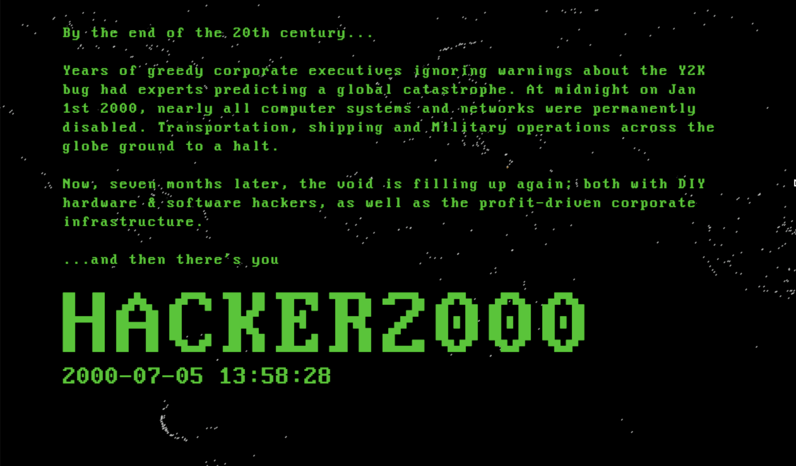

# Hacker2000

</img>

IMPORTANT NOTICE TO THE PLAYER: Despite the fact this is a browser-based game, the simulated computers are created locally on your device. The pretend tools in this videogame, such as SSH, are NOT connecting over the internet to real computers. The DTMF tones from DIAL are NOT makeing real world phone calls. That said, this game does make real network connections for the command AUDIO, which streams music from real urls over the real world internet. Streaming Jungle music (and whatever URLs you add to the playlist) is the only network connection this game will make.

</img>

# Playable alpha: [Click Here](https://doomlazer.github.io/Hacker2000)

Lots of bugs and missing features.

Persistence is currently a work in progress. If the game will not load, trash the database in your browser's JS console with: 

indexedDB.deleteDatabase("VirtualFileSystemDB");

If the game will run, typing the command DELETEALL in-game will also reset everything.

LLM Disclosure: code was generated from an LLM for traversing filesystems, junk email/phone number generation, and the audio player design.